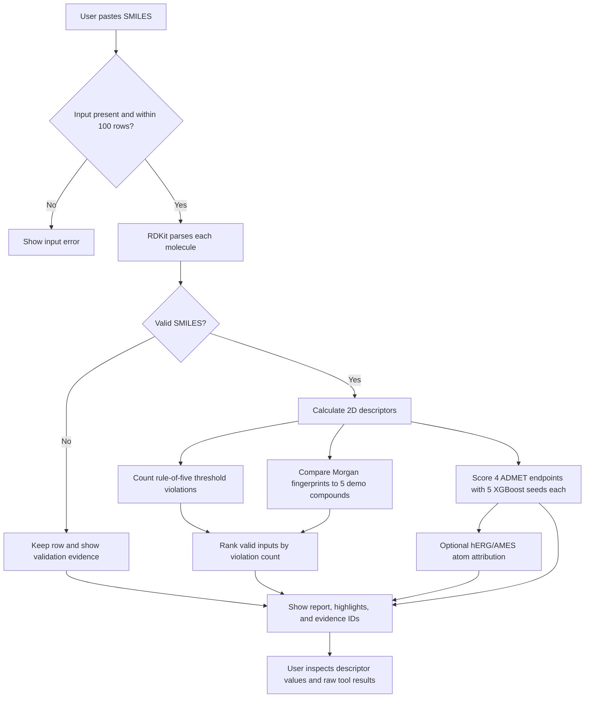
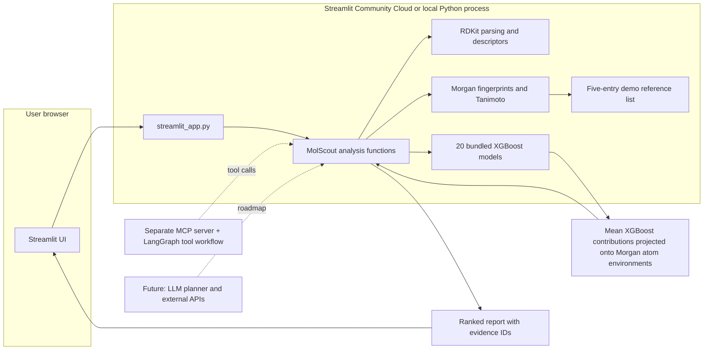
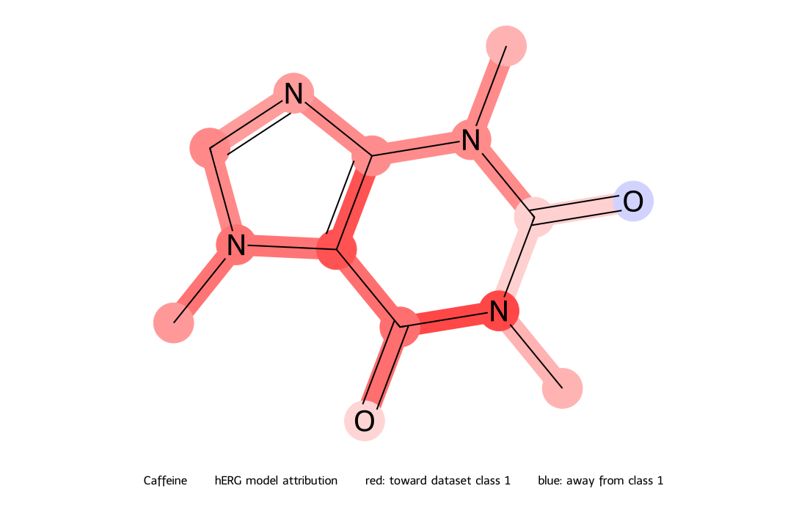

# MolScout

**An auditable molecule-triage demo that combines reproducible RDKit descriptors with four measured TDC ADMET baseline predictions and evidence-linked notes.**

[](https://molscout-rohith-jpg.streamlit.app/)

**Live demo:** [molscout-rohith-jpg.streamlit.app](https://molscout-rohith-jpg.streamlit.app/)

**GitHub:** [rohith-jpg/molscout](https://github.com/rohith-jpg/molscout)

## Problem

Students and early-stage computational chemistry teams often need a quick way to inspect molecule strings and understand what a simple cheminformatics tool actually did. MolScout parses molecules, calculates a small set of reproducible descriptors, and shows the tool output behind each statement. It is an educational triage aid, not a drug-discovery decision system.

## Who it helps

- Students learning SMILES and basic molecular descriptors.
- Software and machine-learning engineers exploring chemistry tooling.
- Small research or biotech teams that want a transparent first-pass structure check for a demo or teaching workflow.
- Interviewers and reviewers who want to inspect the implementation and reproduce its outputs.

## How it works

1. Paste one SMILES string per line.
2. RDKit checks each input and returns its canonical structure or an invalid-input result.
3. RDKit calculates molecular weight, cLogP, hydrogen-bond counts, TPSA, rotatable bonds, and Morgan fingerprints.
4. Five trained Morgan + XGBoost seeds score each molecule on hERG, AMES, BBB_Martins, and Solubility_AqSolDB.
5. MolScout counts Lipinski threshold violations and ranks valid inputs with that explicit heuristic; ADMET scores are shown separately and do not affect rank.
6. On request, XGBoost tree contributions for hERG or AMES are projected from Morgan fingerprint bits onto the matching atom environments and drawn on the molecule.
7. The interface links each descriptor, similarity statement, score, and requested explanation to its supporting tool result.

The public demo runs bundled baseline models locally in the app process and uses no LLM, network lookup, or paid API. The bundled reference list is small and is not a ChEMBL or comprehensive approved-drug index.

## Workflow



## System architecture



The current demo has no database or external API dependency. It loads the 20 bundled baseline models for the four measured endpoints. Chemprop, conformal, and MCP code in the repository is not called by this Streamlit demo. The MCP server now also exposes a LangGraph tool workflow: it creates a deterministic plan, runs independent molecule analyses in a bounded thread pool, ranks by the stated heuristic, and returns claims linked to tool evidence. It does not call an LLM; a learned planner and agent-answer evaluation remain future work.

## Screenshots

Screenshots should come from the running app and show its actual output. Save them in `docs/images/` with these names and captions:

| File | Screen to capture | Caption |
|---|---|---|
| `home.png` | Landing page before analysis | MolScout explains its scope and accepts one SMILES per line. |
| `input.png` | Text area with example molecules entered | The example batch contains three valid structures and one intentionally invalid input. |
| `results.png` | Completed analysis with the first molecule expanded; click the hERG explanation button | Descriptor values, four ADMET baseline outputs, heuristic rank, optional colored atom attribution, claims, evidence IDs, and raw results are visible. |
| `invalid-input.png` | Expand the invalid molecule result | Invalid input is reported with validation evidence instead of being silently dropped. |
| `batch-summary.png` | Capture the batch summary at the top of completed results | Counts of total, parsed, and invalid inputs are visible. |

After capturing, add the real files and uncomment the matching Markdown. For example:

```markdown


```

For a no-cost saved example, open the app with `?demo=1` or click **Replay saved no-cost example**. To capture a fresh result, paste the sample batch and click **Analyze molecules**.

## Results and metrics

Only the local deterministic analysis path has been timed so far. That timing is not an ADMET model score and excludes browser rendering and network latency.

| Metric | Measured result | Measurement scope |
|---|---:|---|
| Median analysis time | 0.00374 s / 3-molecule batch | 50 timed local runs after 3 warmups; Windows 11, Python 3.12.14 |
| P95 analysis time | 0.00525 s / 3-molecule batch | Same run; in-process RDKit analysis only |
| Throughput at median | 801.4 molecules/s | Three fixed sample SMILES divided by measured median batch time |
| Morgan + XGBoost ADMET baseline | Measured below | Five seeds on four TDC endpoints; full values and exclusions are documented below |
| Agent factual accuracy | Not measured | No LLM planner or agent evaluation set is implemented yet |

The captured timing environment and sample inputs are recorded in [`docs/benchmark/demo_latency.json`](docs/benchmark/demo_latency.json). Re-measure on your deployment before comparing it with these local numbers:

```powershell
$env:PYTHONPATH = (Join-Path (Get-Location) 'src')
python scripts/measure_demo_latency.py --repeats 50 --output docs/benchmark/demo_latency.json
```

### Morgan + XGBoost baseline

This is a measured CPU baseline using 2,048-bit Morgan radius-2 fingerprints and XGBoost. It uses the TDC ADMET Benchmark Group scaffold-held-out test data and TDC's default train/validation splitter for five seeds (1–5). Classification uses AUROC; solubility regression uses MAE, where lower is better.

| Dataset | MolScout baseline (mean ± population SD) | Current TDC leaderboard best* |
|---|---:|---:|
| hERG (AUROC) | 0.735 ± 0.013 | 0.880 ± 0.002 (MapLight + GNN) |
| AMES (AUROC) | 0.826 ± 0.003 | 0.871 ± 0.002 (ZairaChem) |
| BBB_Martins (AUROC) | 0.871 ± 0.016 | 0.924 ± 0.003 (MiniMol) |
| Solubility_AqSolDB (MAE) | 1.300 ± 0.035 | 0.741 ± 0.013 (MiniMol) |

The MolScout values are the results of this repository's fixed baseline configuration. The leaderboard values are external reference numbers, not reproduced runs. In the TDC 1.1.15 AqSolDB test data, RDKit could not parse two rows; those rows are recorded and excluded, so the MolScout MAE uses 1,995 of 1,997 test rows. The other three endpoints scored every test row. See the [full per-seed results and run manifest](docs/benchmark/baseline_results.json) for package versions, row counts, parameters, and excluded SMILES. TDC's official pages list the benchmark metrics and current leaderboard results: [hERG](https://tdcommons.ai/benchmark/admet_group/20herg/), [AMES](https://tdcommons.ai/benchmark/admet_group/21ames/), [BBB_Martins](https://tdcommons.ai/benchmark/admet_group/07bbb/), and [Solubility_AqSolDB](https://tdcommons.ai/benchmark/admet_group/06aqsol/). Leaderboard values were checked on 2026-10-14 and can change. Five seeds are included as a small ensemble; the standard deviation displayed in the app is between-model spread, not calibrated prediction uncertainty. Classification outputs are scores for dataset class 1 and must be interpreted using each dataset's label definition.

### Atom-level toxicity attribution

For hERG and AMES, expand a molecule and click **Explain ... score with atom attribution**. MolScout averages XGBoost `pred_contribs` over the five saved seeds, then projects Morgan radius-2 feature contributions onto the atom environments that generated each fingerprint bit. Red atoms push the raw model margin toward dataset class 1; blue atoms push away. The image is an approximate projection because fingerprint hashes can collide and some nonzero contributions may not map to a present atom environment. Contributions are on the raw-margin (log-odds) scale, not probability points. They show associations learned from the dataset, not causal toxicity mechanisms or experimental findings. Each explanation is also added to the report's evidence list as `explain_prediction`.

This is the generated hERG attribution output for caffeine from the five saved baseline models (not a screenshot or a toxicity finding):



Recreate it after installing the local app dependencies with `python scripts/render_attribution_example.py`.

To rerun from a Python 3.12 environment, first install MolScout's core dependencies and then the small TDC runtime dependency set. The requirements file avoids pulling PyTDC's unrelated model-serving dependencies:

```powershell
python -m pip install -e .
python -m pip install --no-deps -r requirements-benchmark.txt
$env:PYTHONPATH = (Join-Path (Get-Location) 'src')
python -m molscout.benchmark --output-dir outputs/baseline --seeds 1 2 3 4 5
```

The runner writes metrics, a package/version manifest, and model artifacts under `outputs/baseline/`. Its 20 model JSON files are copied to `models/baseline/` and versioned so the public app can load them; downloaded TDC data and run outputs remain ignored by Git. A future agent comparison should use a fixed, manually reviewed question set and score the same answers with tools enabled and disabled.

### Conformal prediction

The AqSolDB split-conformal runner trains on TDC's train partition, uses validation as the calibration partition, and measures 90% interval coverage on the fixed scaffold test set. It writes per-molecule intervals, test MAE, empirical coverage, mean interval width, and a list of invalid test SMILES excluded from scoring. The five-seed run completed; its measured aggregate and per-seed results are reported below and in [`docs/benchmark/conformal_results.json`](docs/benchmark/conformal_results.json):

```powershell
python -m pip install -e ".[uncertainty]"
$env:PYTHONPATH = (Join-Path (Get-Location) 'src')
python -m molscout.conformal --output-dir outputs/conformal --seeds 1 2 3 4 5 --confidence-level 0.9
```

The reported test coverage is an observed result, not a guarantee: scaffold-held-out molecules can differ from the train and calibration distributions, which weakens the exchangeability assumption behind split conformal prediction.

Five seeds were measured with MAPIE 1.5.0 and TDC 1.1.15. Mean test MAE was **1.300 ± 0.035 log10(mol/L)**, empirical coverage was **91.6% ± 3.2%** for nominal 90% intervals, and mean interval width was **5.673 ± 0.649 log10(mol/L)** (mean ± population SD). Each seed scored 1,995 of 1,997 scaffold test rows; two invalid SMILES were explicitly excluded. Coverage ranged from 88.2% to 96.7% across seeds, which shows why the observed result is not a per-chemistry guarantee. Per-seed details are in [`docs/benchmark/conformal_results.json`](docs/benchmark/conformal_results.json). The live app currently displays this validation summary; it does not yet return calibrated AqSolDB intervals for new inputs.

### Chemprop graph neural network comparison

The Chemprop runner now exports test-set predictions after training and reports the same task metric used by the XGBoost baseline (AUROC for hERG, AMES, and BBB_Martins; MAE for AqSolDB). It feeds TDC's train, validation, and scaffold test files directly to Chemprop, averages its internal model ensemble, and records invalid test rows. Chemprop is optional and is not installed in the Streamlit app. Start with one endpoint and one seed on a GPU runtime before expanding the run:

```powershell
python -m pip install -e .
python -m pip install --no-cache-dir --index-url https://download.pytorch.org/whl/cpu "torch>=2.2,<3"
python -m pip install "chemprop>=2.2,<3" "xgboost>=2,<4"
python -m pip install --no-deps -r requirements-benchmark.txt
$env:PYTHONPATH = (Join-Path (Get-Location) 'src')
python -m molscout.chemprop_runner --output-dir outputs/chemprop --tasks hERG --seeds 1 --ensemble-size 5
```

The runner writes each seed's test scores, prediction CSV, excluded-row list, and training/prediction logs. The measured pilot below covers hERG, one seed, and a five-model ensemble; expand to more endpoints and seeds only after checking runtime and available memory.

**Measured pilot:** Chemprop 2.3.1 completed a five-model hERG ensemble on CPU for seed 1 using TDC's official scaffold-held-out test rows. AUROC was **0.805** versus **0.755** for MolScout's Morgan + XGBoost baseline on the same seed and 132 test molecules (no invalid test rows excluded). This is one seed on a small test set, so it is a pilot comparison, not evidence that Chemprop is generally better. See [`docs/benchmark/chemprop_hERG_pilot.json`](docs/benchmark/chemprop_hERG_pilot.json) for exact values and versions. The run exposed a Chemprop 2.3 CLI output-column difference; the evaluator now accepts its target-named ensemble output.

## LangGraph and MCP workflow

Install the optional agent dependencies, point the server at the checked-in baseline models, and start the stdio MCP server:

```powershell
python -m pip install -e ".[agent]"
$env:MOLSCOUT_MODEL_DIR = (Join-Path (Get-Location) 'models/baseline')
python -m molscout.mcp_server
```

The `triage_with_agent` MCP tool plans the requested endpoints, runs independent molecule workflows concurrently (up to four by default), ranks valid inputs by the documented rule-of-five heuristic, and returns evidence IDs for every result claim. This is a LangGraph orchestration workflow; it has no LLM planner, and the rank is not a drug-candidate score. The separate MCP server is not required by the public Streamlit demo.

## Tech stack

| Tool | Used for |
|---|---|
| Python 3.12 | App runtime and reusable analysis code |
| Streamlit | Free-host-friendly browser UI and no-cost demo replay |
| RDKit | SMILES parsing, descriptors, Morgan fingerprints, and drawing atom environments |
| XGBoost tree contributions | Per-molecule feature attribution for hERG/AMES, projected onto RDKit Morgan atom environments |
| NumPy + scikit-learn | Fingerprint arrays and XGBoost's sklearn model API |
| Tanimoto similarity | Transparent structural-neighbor score for the bundled examples |
| PyTDC + XGBoost | Five-seed ADMET baseline; saved XGBoost models power the live demo |
| Chemprop + MAPIE | Five-model Chemprop hERG pilot measured on one official split; MAPIE split-conformal intervals measured on AqSolDB |
| LangGraph + MCP | Optional stdio tool server; deterministic parallel tool workflow returns evidence-linked reports, while the UI calls Python functions directly |

## Run locally

Python 3.12 is recommended. From the repository root:

```powershell
py -3.12 -m venv .venv
.\.venv\Scripts\Activate.ps1
python -m pip install -r requirements.txt
$env:STREAMLIT_CONFIG_DIR = (Join-Path (Get-Location) '.streamlit')
streamlit run streamlit_app.py
```

Open the local address printed by Streamlit. The saved example replays actual outputs from the bundled baseline models without network APIs or secrets. Click **Analyze molecules** to score a different SMILES batch.

To run the optional FastAPI/CLI/model code, install its corresponding extras from `pyproject.toml`. The benchmark command downloads TDC data on its first run and saves trained models locally. The app uses the checked-in inference copies under `models/baseline/`.

## Deploy on Streamlit Community Cloud

Streamlit Community Cloud hosts the public demo because this version is a Python-only UI, and its free workflow deploys directly from a public GitHub repository. The deployed app uses the root-level entrypoint and requirements file, with Python 3.12 selected in Advanced settings.

1. Push the latest `main` branch to [GitHub](https://github.com/rohith-jpg/molscout).
2. Sign in at [share.streamlit.io](https://share.streamlit.io/) with the GitHub account that owns `rohith-jpg/molscout`.
3. Select **Create app**, then choose repository `rohith-jpg/molscout`, branch `main`, and entrypoint `streamlit_app.py`.
4. In **Advanced settings**, select Python 3.12.
5. Choose an available app subdomain and click **Deploy**.
6. Wait for the build to finish, open the generated URL, and test both the saved example and a custom SMILES batch.

No secrets are required. The public app is live at [molscout-rohith-jpg.streamlit.app](https://molscout-rohith-jpg.streamlit.app/). After pushing changes to `main`, Streamlit Community Cloud rebuilds the app automatically.

## Why this matters

This gives a student or software engineer a quick, inspectable way to turn a molecule string into basic structure descriptors and see exactly where each displayed claim came from. Someone can use the saved demo today to learn how SMILES parsing, descriptor calculation, and simple fingerprint similarity fit together. The output is a starting point for exploration, not evidence that a molecule will work as a medicine.

## Future improvements

- Export Chemprop ensemble predictions and compare them on the same fixed splits.
- Compare atom attributions with a second explanation method and test their stability across held-out scaffolds.
- Expand the reference catalog with a documented, licensed source.
- Add an LLM planner after building a reviewed tool-call evaluation set; the current LangGraph workflow uses a deterministic plan.
- Add a manually reviewed evaluation set for agent answers and report both accuracy and failure cases.

## Author

[Rohith Singhu](https://github.com/rohith-jpg) · [GitHub](https://github.com/rohith-jpg) · [LinkedIn](https://www.linkedin.com/in/rohith-singhu-24b8a0249)


