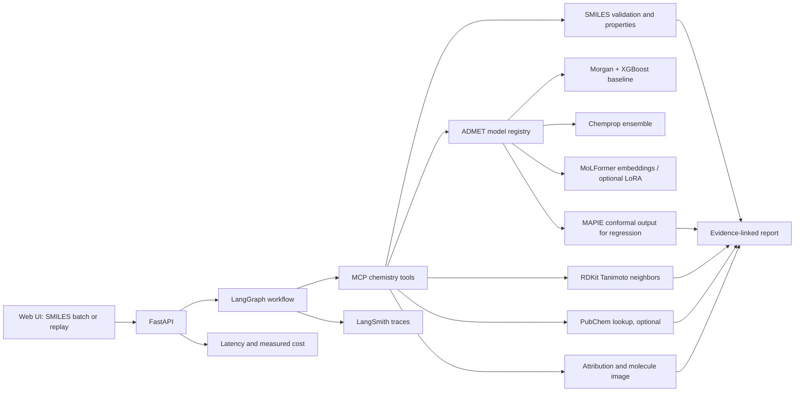

# MolScout

**Evidence-backed molecular property triage.** Paste SMILES, inspect molecule structures and computed properties, compare model predictions, and see the tool outputs supporting each report claim.

MolScout is a portfolio project, not a clinical or drug-safety decision system. Predictions are assay-specific and should not be treated as experimental results.

## Project status

Implemented now: RDKit validation and descriptors, Morgan fingerprints, a TDC/XGBoost baseline runner, an explicit-split Chemprop ensemble training runner, a MAPIE split-conformal evaluation runner for AqSolDB, a registry that loads saved endpoint models, a stdio MCP server, batch CLI analysis, evidence-linked claims, an offline five-compound similarity demo, and a small FastAPI browser UI. The batch rank is a transparent Lipinski-threshold heuristic; it is not an ADMET model or a drug-candidate score. The local similarity catalog is only for demonstrating the tool contract; it is not ChEMBL and is not a comprehensive approved-drug index.

Not implemented yet: trained ADMET predictor artifacts, Chemprop prediction export/metrics, MoLFormer fine-tuning, atom attribution, a LangGraph/LLM planner, PubChem integration, and production deployment. The Chemprop and conformal runners are code paths only; no models have been trained and no performance, GPU-memory, latency, or cost numbers are claimed. The UI is local-only.

## Initial scope

The first benchmark targets are the TDC ADMET scaffold-split tasks:

| TDC task | Type | Official metric |
|---|---|---|
| hERG | Binary classification | AUROC |
| AMES | Binary classification | AUROC |
| BBB_Martins | Binary classification | AUROC |
| Solubility_AqSolDB | Regression | MAE |

Metrics are evaluated separately by endpoint. The app will not combine unlike metrics into a single score unless a user chooses an explicit ranking rule. TDC describes its benchmark group and protocol in its [ADMET overview](https://tdcommons.ai/benchmark/admet_group/overview/) and [leaderboard guide](https://tdcommons.ai/benchmark/overview/).

## Architecture



## Repository layout

```text
src/molscout/       Chemistry, analysis, similarity, benchmark, CLI, API, and MCP server code
tests/              Unit tests for the implemented components
outputs/            Local training outputs; do not commit large model files
```

## Setup

Python 3.11 is the target. RDKit installation varies by platform; if `pip install -e '.[dev]'` fails, use a conda-forge RDKit environment and install the remaining dependencies from `pyproject.toml`.

```bash
python -m venv .venv
# Activate the environment, then:
python -m pip install -e '.[dev]'
pytest
```

## First commands

Validate a molecule and inspect calculated properties:

```bash
molscout validate 'CCO'
```

Analyze a batch, rank valid entries by the number of rule-of-five threshold
violations, and inspect the result IDs cited by each claim:

```bash
molscout analyze 'CCO' 'CC(=O)O' 'not-a-smiles'
```

The nearest-neighbor result uses a bundled, five-molecule demo catalog so the
command works offline. It reports Morgan radius 2 / 2048-bit Tanimoto similarity
and explicitly identifies this catalog as incomplete.

Run the local browser demo and JSON API:

```bash
python -m pip install -e '.[api]'
uvicorn molscout.api:app --reload
```

Open `http://127.0.0.1:8000`. The `/api/analyze` endpoint returns the same
evidence-linked report as the CLI, and `/docs` exposes the generated API schema.

Train/evaluate Morgan + XGBoost on the TDC tasks (downloads benchmark data on first use):

```bash
python -m molscout.benchmark --output-dir outputs/baseline --seeds 1 2 3 4 5
```

This writes each model to `outputs/baseline/<endpoint>/seed-<n>/model.json`, per-seed metrics to `summary.json`, mean/population-standard-deviation summaries to `aggregate.json`, and seeds, package versions, split description, fingerprint settings, and model parameters to `run_manifest.json`. TDC recommends at least five independent runs for leaderboard-style reporting. Never tune on the held-out test set.

Train Chemprop ensembles on the exact TDC train/validation/test CSV partitions
(this downloads data and trains models; start with one endpoint before running
all four):

```bash
python -m pip install -e '.[gnn,benchmark]'
molscout-chemprop --tasks Solubility_AqSolDB --seeds 1 --ensemble-size 5
```

The runner writes the exact CSV splits, full CLI command, training log, and model
checkpoints under `outputs/chemprop/`. It passes three explicit CSVs to
Chemprop, so Chemprop does not create a second split. It currently records the
training artifact but does not yet export Chemprop test metrics or predictions.

Measure 90% split-conformal intervals for AqSolDB. The TDC training partition
fits the XGBoost model, TDC validation partition calibrates intervals, and the
fixed scaffold test set is used once for measurement:

```bash
python -m pip install -e '.[benchmark,uncertainty]'
molscout-conformal --seeds 1 2 3 4 5
```

This writes per-molecule bounds and reports empirical test coverage, MAE, and
mean interval width. Split conformal's coverage guarantee depends on
exchangeability; scaffold-held-out evaluation can violate that assumption, so
the measured test coverage is reported without promising nominal coverage.

After training, predict one supported endpoint with the saved seed models:

```bash
molscout predict 'CCO' --endpoint hERG
```

`ensemble_std` is the spread among the saved seed models, not calibrated uncertainty. The prediction command fails clearly when that endpoint has no model artifacts; it never substitutes a placeholder score.

Run the MCP server over stdio:

```bash
python -m molscout.mcp_server
```

## Planned model and evaluation milestones

1. Morgan fingerprints + XGBoost baseline across four tasks.
2. Chemprop graph ensembles on the same explicit TDC partitions; add prediction export and metric comparison.
3. Frozen MoLFormer embeddings across tasks; time-boxed LoRA vs full fine-tuning on AqSolDB only.
4. MAPIE 90% nominal regression intervals on AqSolDB, with empirical test coverage and interval width reported. Calibration uses training/validation data only. Coverage is not guaranteed for every chemical subgroup or under scaffold distribution shift.
5. MCP tools and a LangGraph workflow that calls deterministic tools, records evidence, and abstains when model uncertainty or similarity is concerning.
6. Small UI, Docker, CI, tracing, and saved-run replay mode.

## Scientific and operational limits

- A prediction is a model estimate for a particular assay endpoint, not a universal property or a clinical claim.
- Atom highlights are model attributions, not causal explanations.
- Similarity is computed with a specified method (initially Morgan fingerprints and Tanimoto); similarity does not establish shared efficacy or safety.
- External lookups are optional and cached where possible. A saved demo replay must work without network access, model hosting, or LLM credentials.
- Results, latency, memory, and cost will be added only after they are measured.

## Technologies

**Used in the current implementation:** Python, RDKit, NumPy, scikit-learn,
XGBoost, Typer, FastAPI (API extra), PyTDC (benchmark extra), pytest (tests),
and MCP (agent extra).

**Implemented as optional runners, not yet trained:** Chemprop and MAPIE. **Planned:** Hugging Face Transformers/PEFT, LangGraph,
FastAPI, Docker, GitHub Actions, and LangSmith. They are listed as roadmap items,
not as completed integrations.
