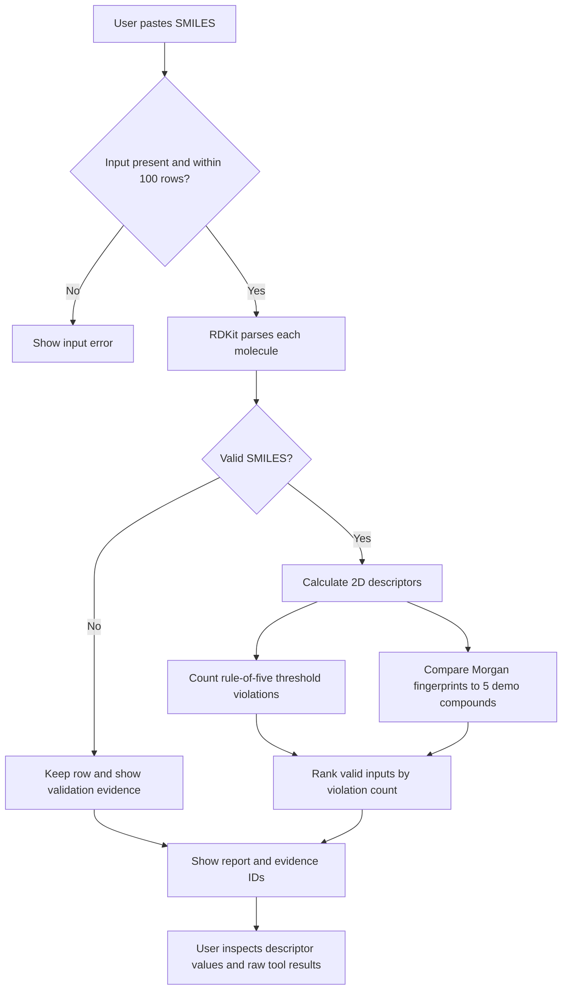
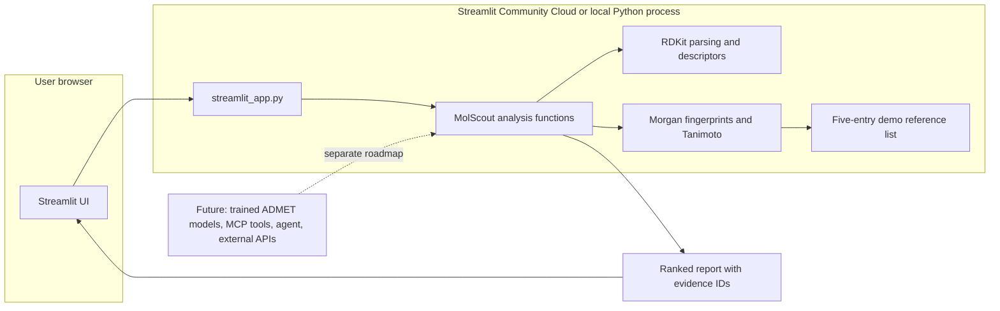

# MolScout

**An auditable molecule-triage demo that turns pasted SMILES into reproducible RDKit descriptors and evidence-linked notes.**

**Live demo:** Not deployed yet. The app is prepared for Streamlit Community Cloud; its account connection and deployment still need to be completed.

**GitHub:** [rohith-jpg/molscout](https://github.com/rohith-jpg/molscout)

## Problem

Students and early-stage computational chemistry teams often need a quick way to inspect molecule strings and understand what a simple cheminformatics tool actually did. MolScout parses molecules, calculates a small set of reproducible descriptors, and shows the tool output behind each statement. It is an educational triage aid, not a drug-discovery decision system.

## Who it helps

- Students learning SMILES and basic molecular descriptors.
- Software and machine-learning engineers exploring chemistry tooling.
- Small research or biotech teams that want a transparent first-pass structure check for a demo or teaching workflow.
- Interviewers and reviewers who want to inspect the implementation and reproduce its outputs.

## How it works

1. Paste one SMILES string per line.
2. RDKit checks each input and returns its canonical structure or an invalid-input result.
3. RDKit calculates molecular weight, cLogP, hydrogen-bond counts, TPSA, and rotatable bonds.
4. MolScout counts Lipinski threshold violations and ranks valid inputs with that explicit heuristic.
5. Morgan fingerprints compare each valid molecule with five bundled example compounds.
6. The interface links each report claim to the tool result that supports it.

The current public-demo path is deterministic and uses no LLM, trained ADMET model, network lookup, or paid API. The bundled reference list is small and is not a ChEMBL or comprehensive approved-drug index.

## Workflow



## System architecture



The current demo has no database or external API dependency. Optional benchmark, Chemprop, conformal, and MCP code in the repository is not called by this Streamlit demo.

## Screenshots

Screenshots should come from the running app and show its actual output. Save them in `docs/images/` with these names and captions:

| File | Screen to capture | Caption |
|---|---|---|
| `home.png` | Landing page before analysis | MolScout explains its scope and accepts one SMILES per line. |
| `input.png` | Text area with example molecules entered | The example batch contains three valid structures and one intentionally invalid input. |
| `results.png` | Completed analysis with the first molecule expanded and raw tool results open | Descriptor values, heuristic rank, nearest demo-catalog entries, claims, evidence IDs, and raw results are visible. |
| `invalid-input.png` | Expand the invalid molecule result | Invalid input is reported with validation evidence instead of being silently dropped. |
| `batch-summary.png` | Capture the batch summary at the top of completed results | Counts of total, parsed, and invalid inputs are visible. |

After capturing, add the real files and uncomment the matching Markdown. For example:

```markdown


```

For a no-cost saved example, open the app with `?demo=1` or click **Replay saved no-cost example**. To capture a fresh result, paste the sample batch and click **Analyze molecules**.

## Results and metrics

Only the local deterministic analysis path has been timed so far. That timing is not an ADMET model score and excludes browser rendering and network latency.

| Metric | Measured result | Measurement scope |
|---|---:|---|
| Median analysis time | 0.00374 s / 3-molecule batch | 50 timed local runs after 3 warmups; Windows 11, Python 3.12.14 |
| P95 analysis time | 0.00525 s / 3-molecule batch | Same run; in-process RDKit analysis only |
| Throughput at median | 801.4 molecules/s | Three fixed sample SMILES divided by measured median batch time |
| ADMET AUROC / MAE | Not measured | No trained endpoint model artifacts are included |
| Agent factual accuracy | Not measured | No LLM planner or agent evaluation set is implemented yet |

The captured timing environment and sample inputs are recorded in [`docs/benchmark/demo_latency.json`](docs/benchmark/demo_latency.json). Re-measure on your deployment before comparing it with these local numbers:

```powershell
$env:PYTHONPATH = (Join-Path (Get-Location) 'src')
python scripts/measure_demo_latency.py --repeats 50 --output docs/benchmark/demo_latency.json
```

The baseline benchmark code reports per-endpoint AUROC for hERG, AMES, and BBB_Martins, and MAE for Solubility_AqSolDB on TDC's scaffold-held-out test data. It writes results only after the benchmark is actually run; no score is filled in here. A future agent comparison should use a fixed, manually reviewed question set and score the same answers with tools enabled and disabled.

## Tech stack

| Tool | Used for |
|---|---|
| Python 3.12 | App runtime and reusable analysis code |
| Streamlit | Free-host-friendly browser UI and no-cost demo replay |
| RDKit | SMILES parsing, molecular descriptors, and Morgan fingerprints |
| NumPy | Fingerprint arrays and measured evaluation utilities |
| Tanimoto similarity | Transparent structural-neighbor score for the bundled examples |
| PyTDC + XGBoost | Optional benchmark implementation; not part of the live demo and not trained yet |
| Chemprop + MAPIE | Optional ensemble/conformal runners; no trained result artifacts yet |
| MCP | Chemistry tool server available separately; the current UI calls the Python functions directly |

## Run locally

Python 3.12 is recommended. From the repository root:

```powershell
py -3.12 -m venv .venv
.\.venv\Scripts\Activate.ps1
python -m pip install -r requirements.txt
$env:STREAMLIT_CONFIG_DIR = (Join-Path (Get-Location) '.streamlit')
streamlit run streamlit_app.py
```

Open the local address printed by Streamlit. The saved example works without model weights, network APIs, or secrets.

To run the optional FastAPI/CLI/model code, install its corresponding extras from `pyproject.toml`. See the source modules before running benchmark commands; TDC downloads data, and model training consumes compute.

## Deploy on Streamlit Community Cloud

Streamlit Community Cloud is the chosen host because this version is a Python-only UI, and its free workflow deploys directly from a public GitHub repository. Its official setup expects a root-level entrypoint and requirements file. Choose Python 3.12 in Advanced settings to match this package's supported range.

1. Push the latest `main` branch to [GitHub](https://github.com/rohith-jpg/molscout).
2. Sign in at [share.streamlit.io](https://share.streamlit.io/) with the GitHub account that owns `rohith-jpg/molscout`.
3. Select **Create app**, then choose repository `rohith-jpg/molscout`, branch `main`, and entrypoint `streamlit_app.py`.
4. In **Advanced settings**, select Python 3.12.
5. Choose an available app subdomain and click **Deploy**.
6. Wait for the build to finish, open the generated URL, and test both the saved example and a custom SMILES batch.

No secrets are required. The account authorization and final app creation have not been completed from this workspace, so a public URL is intentionally not claimed yet. Once Streamlit assigns the URL, put it below and use it as the README badge target:

```markdown
[](PASTE_DEPLOYED_URL_HERE)
```

## Why this matters

This gives a student or software engineer a quick, inspectable way to turn a molecule string into basic structure descriptors and see exactly where each displayed claim came from. Someone can use the saved demo today to learn how SMILES parsing, descriptor calculation, and simple fingerprint similarity fit together. The output is a starting point for exploration, not evidence that a molecule will work as a medicine.

## Future improvements

- Train and report the four TDC endpoint baselines with saved, reproducible metrics.
- Export Chemprop ensemble predictions and compare them on the same fixed splits.
- Add validated model-based explanation and uncertainty results.
- Expand the reference catalog with a documented, licensed source.
- Add MCP-backed tool orchestration only when each tool's output is validated and cited.
- Add a manually reviewed evaluation set for agent answers and report both accuracy and failure cases.

## Author

[Rohith Singhu](https://github.com/rohith-jpg) · [GitHub](https://github.com/rohith-jpg) · [LinkedIn](https://www.linkedin.com/in/rohith-singhu-24b8a0249)
