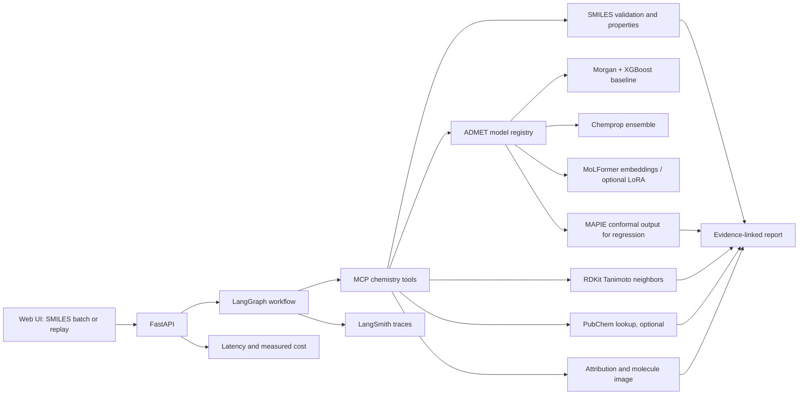

# MolScout

**Evidence-backed molecular property triage.** Paste SMILES, inspect molecule structures and computed properties, compare model predictions, and see the tool outputs supporting each report claim.

MolScout is a portfolio project, not a clinical or drug-safety decision system. Predictions are assay-specific and should not be treated as experimental results.

## Project status

This repository starts with the chemistry utilities, TDC benchmark configuration, Morgan/XGBoost baseline, MCP tool-server entry point, and unit tests. Chemprop, MoLFormer/PEFT, conformal calibration, retrieval, agent orchestration, web UI, and deployment are planned milestones; no model results are claimed yet.

## Initial scope

The first benchmark targets are the TDC ADMET scaffold-split tasks:

| TDC task | Type | Official metric |
|---|---|---|
| hERG | Binary classification | AUROC |
| AMES | Binary classification | AUROC |
| BBB_Martins | Binary classification | AUROC |
| Solubility_AqSolDB | Regression | MAE |

Metrics are evaluated separately by endpoint. The app will not combine unlike metrics into a single score unless a user chooses an explicit ranking rule. TDC describes its benchmark group and protocol in its [ADMET overview](https://tdcommons.ai/benchmark/admet_group/overview/) and [leaderboard guide](https://tdcommons.ai/benchmark/overview/).

## Architecture



## Repository layout

```text
src/molscout/       Chemistry, benchmark, baseline, and MCP server code
tests/              Unit tests
outputs/            Local training outputs; do not commit large model files
```

## Setup

Python 3.11 is the target. RDKit installation varies by platform; if `pip install -e '.[dev]'` fails, use a conda-forge RDKit environment and install the remaining dependencies from `pyproject.toml`.

```bash
python -m venv .venv
# Activate the environment, then:
python -m pip install -e '.[dev]'
pytest
```

## First commands

Validate a molecule and inspect calculated properties:

```bash
molscout validate 'CCO'
```

Train/evaluate Morgan + XGBoost on the TDC tasks (downloads benchmark data on first use):

```bash
python -m molscout.benchmark --output-dir outputs/baseline --seeds 1
```

The initial run uses one seed as a smoke test. For leaderboard-style reporting, use multiple independent runs; TDC's guide recommends at least five. Never tune on the held-out test set.

Run the MCP server over stdio:

```bash
python -m molscout.mcp_server
```

## Planned model and evaluation milestones

1. Morgan fingerprints + XGBoost baseline across four tasks.
2. Chemprop graph models; ensemble uncertainty first on AqSolDB.
3. Frozen MoLFormer embeddings across tasks; time-boxed LoRA vs full fine-tuning on AqSolDB only.
4. MAPIE 90% nominal regression intervals on AqSolDB, with empirical test coverage and interval width reported. Calibration uses training/validation data only. Coverage is not guaranteed for every chemical subgroup or under scaffold distribution shift.
5. MCP tools and a LangGraph workflow that calls deterministic tools, records evidence, and abstains when model uncertainty or similarity is concerning.
6. Small UI, Docker, CI, tracing, and saved-run replay mode.

## Scientific and operational limits

- A prediction is a model estimate for a particular assay endpoint, not a universal property or a clinical claim.
- Atom highlights are model attributions, not causal explanations.
- Similarity is computed with a specified method (initially Morgan fingerprints and Tanimoto); similarity does not establish shared efficacy or safety.
- External lookups are optional and cached where possible. A saved demo replay must work without network access, model hosting, or LLM credentials.
- Results, latency, memory, and cost will be added only after they are measured.

## Technologies

Python, RDKit, PyTDC, XGBoost, Chemprop, Hugging Face Transformers/PEFT, MAPIE, MCP, LangGraph, FastAPI, Docker, GitHub Actions, and LangSmith. Stretch integrations are clearly identified in the code and README until implemented.
